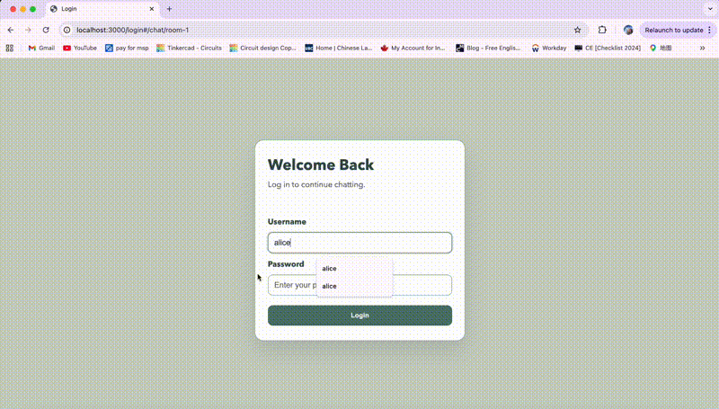
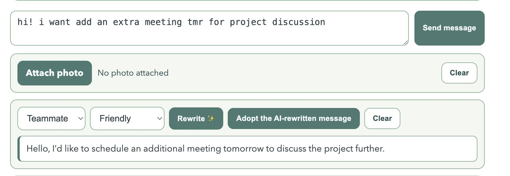
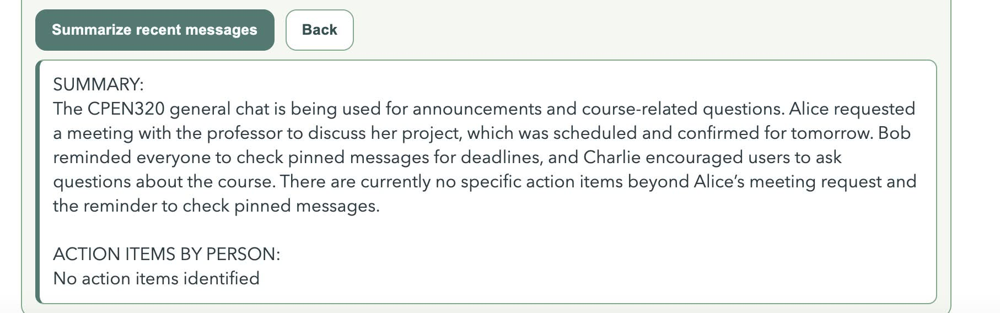
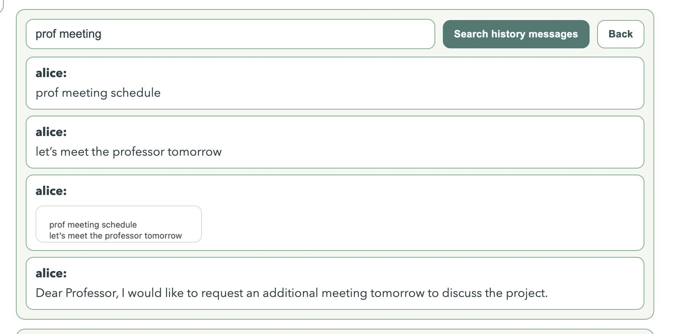

# Chat App with Local AI Features


This project is a real-time chat application with local AI features powered by LM Studio.

## Demo


## Features

### Core chat
- **Login/logout with session cookies**
  - Secure authentication. Log in with your username and password. Sessions persist until you log out.
  - Example: Log in as `alice` (password: `secret`) or `bob` (password: `password`).

- **Multiple chat rooms with sidebar room switching**
  - Easily switch between different chat rooms using the sidebar. Each room has its own message history.
  - Example: Click a room name in the sidebar to join and view its conversation.

- **Real-time message delivery over WebSocket**
  - Messages are instantly delivered to all users in the same room using WebSockets.
  - Example: Type a message and see it appear for all participants without refreshing.

- **Persistent conversation history in MongoDB**
  - All messages are stored in MongoDB and loaded when you enter a room.
  - Example: Join a room and see previous messages, even after logging out and back in.

- **Automatic history loading when entering a room**
  - No need to scroll or reload; history appears automatically.

- **Image attachments in messages**
  - Upload and send images in chat. Images are displayed inline with messages.
  - Example: Click the attachment icon, select an image, and send.

### AI features

## AI Features

### Feature 1: Rewriting Messages

**Brief explanation:**
Rewrite your draft message to match a specific audience and tone. The AI understands your intent and rewrites the text accordingly.

**How it works:**
- When you request a rewrite, your draft message, selected audience, and tone are sent to the backend.
- The backend uses the `google/gemma-3-4b` model (via LM Studio) to generate a rewritten version tailored to your settings.

**How to use:**
1. Type your draft message in the chat input box.
2. Select the rewrite option (choose audience and tone).
3. The AI will suggest a rewritten version tailored to your selection.

**Examples:**
- Draft: "can you help me?"
- Rewrite for professor, formal: "Dear Professor, could you please assist me with this issue?"
- Rewrite for teammate, friendly: "Hey, could you give me a hand with this?"

**Visual Examples:**



**Notes:**
- Audience options: professor, TA, teammate, supervisor.
- Tone options: formal, friendly, concise, etc.
- Model: `google/gemma-3-4b` (text generation)
- Useful for making your communication more effective and appropriate for the recipient.

---

### Feature 2: Chat Summarization

**Brief explanation:**
Summarize the current chat thread, including both text and image captions, and extract tasks by person.

**How it works:**
- The backend collects all messages and image captions in the current room.
- The `google/gemma-3-4b` model (via LM Studio) generates a summary and a list of tasks by person.

**How to use:**
1. Click the summarize button in a chat room.
2. The AI generates a summary and lists tasks assigned to each participant.

**Examples:**
- Summary: "Discussed project deadlines and assigned tasks."
- Tasks by person: "Alice: Write report. Bob: Prepare slides."

**Visual Example:**


**Notes:**
- Summarization includes both text and image captions from the thread.
- Model: `google/gemma-3-4b` (text summarization)
- Helps quickly catch up on long conversations or meetings.

---

### Feature 3: Semantic + Keyword Message Search

**Brief explanation:**
Find messages using both keyword and semantic (meaning-based) search for more accurate results.

**How it works:**
- When you search, the backend computes both keyword matches and embedding similarity.
- The `text-embedding-google_embeddinggemma-300m-qat` model generates embeddings for each message and your query.
- Results are ranked by a hybrid of lexical and semantic similarity.

**How to use:**
1. Enter a search term in the search bar.
2. The app displays a list of the best-matching messages in a dedicated search results panel below the search bar.

**Examples:**
- Search for "deadline" finds "Project due next week" even if "deadline" isn’t in the message.
- Search for "meeting notes" finds related discussions about meetings.

**Visual Example:**


**Notes:**
- Combines keyword and semantic (meaning-based) search for best results.
- Model: `text-embedding-google_embeddinggemma-300m-qat` (embeddings)

---

### Feature 4: Image Captioning

**Brief explanation:**
Automatically generate a descriptive caption for any image uploaded to chat. The caption is not shown in the UI, but is used by the backend to enhance search and summarization features.

**How it works:**
- When you upload an image, the backend sends it to the `qwen/qwen3-vl-8b` model (via LM Studio).
- The model generates a caption, which is stored with the message in the backend.
- The caption is used as additional context for AI-powered search and chat summarization.

**How to use:**
1. Attach an image to your message.
2. After message is sent in chat, the caption is generated and saved in the backend.


**Examples:**
- Upload a screenshot of code. The backend generates: "Screenshot showing JavaScript function for message handling."
- Upload a group photo. The backend generates: "Photo of the project team in the lab."

**Notes:**
- Captions are generated as soon as an image is uploaded.
- Model: `qwen/qwen3-vl-8b` (vision-language, image captioning)
- Captions are only used for AI search and summarization, not shown in the chat UI.
- Improves searchability and summary quality for image content.


## Tech stack
- Node.js (recommended: 18+)
- Express
- WebSocket (`ws`)
- MongoDB
- LM Studio local server (OpenAI-compatible API on `http://127.0.0.1:1234`)


## Prerequisites


1. Node.js installed
2. MongoDB installed and running
3. LM Studio installed
4. Models downloaded in LM Studio (see model section below)


## 1) Install dependencies


From project root:


```powershell
npm install
```


## 2) Start MongoDB


Use whichever option works on your machine:


### Option A: MongoDB as a Windows service
```powershell
Start-Service MongoDB
```


### Option B: run `mongod` manually
```powershell
mongod --dbpath C:\path\to\your\mongodb-data
```


If `mongod` is not recognized, MongoDB is either not installed or not in PATH.


## 3) Seed database (rooms + sample conversations + users)


From project root:


```powershell
mongosh --file initdb.mongo
mongosh --file src/initUsers.mongo
```


This seeds database: `cpen322-messenger`.


Notes:
- `initdb.mongo` seeds chat rooms and a starter conversation.
- `src/initUsers.mongo` seeds users (`alice`, `bob`) with hashed passwords.
- alice password is "secret"
- bob password is "password"


## 4) Setup LM Studio


### Start LM Studio API server
1. Open LM Studio
2. Go to **Developer** tab
3. Start server on `127.0.0.1:1234`


### Download/load recommended models


This repo expects these model IDs by default:


1. `google/gemma-3-4b`
   - Used for rewrite + text summarization
2. `text-embedding-google_embeddinggemma-300m-qat`
   - Used for embeddings (semantic search + per-message embeddings)
3. `qwen/qwen3-vl-8b`
   - Used for image captioning


Important:
- Frontend WebSocket currently targets port `8000` in client code, so keep `WS_PORT=8000` unless you also update client WS URL logic.


## 6) Run the app


```powershell
node server.js
```


Open:


```text
http://localhost:3000/login
```


## AI behavior notes

### Summarization output format

**Current format:**

```
Summary:
<summary text>

Tasks by person:
<person>: <task>
<person>: <task>
```

Example:
```
Summary:
Discussed project requirements and assigned roles.

Tasks by person:
Alice: Set up database
Bob: Create UI mockups
```

### Search ranking

**Search is hybrid:**
- Lexical match (keywords/whole words)
- Semantic embedding similarity (finds related concepts, not just exact words)

The app auto-jumps to the top-ranked match in the current room for fast navigation.


## Project structure


```text
server.js            Express + WebSocket server + AI routes
database.js          MongoDB data access layer
AI_features.js       LM Studio/OpenAI-client AI logic
client/app.js        Frontend app logic
client/style.css     UI styling
client/index.html    Main app shell
client/login.html    Login page
initdb.mongo         Room + conversation seed data
src/initUsers.mongo  User seed data
```


